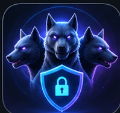
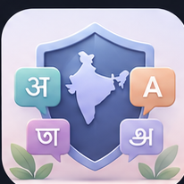

<div align="center">

<!-- 3D-STYLE ANIMATED HERO -->


<br/>

### COMPUTER SCIENCE & ENGINEERING (ARTIFICIAL INTELLIGENCE)


<br/>

<!-- SOCIAL LINKS -->
<a href="https://arnavsharma-ind.github.io/ArnavUpdatedPortfolio/">

</a>
<a href="https://www.linkedin.com/in/arnav-sharma-dev/">

</a>
<a href="https://x.com/_i_arnavsharma_">

</a>
<a href="https://www.instagram.com/_itsme.arnav_/">

</a>
<a href="https://my-journey-jet.vercel.app/#">

</a>
<a href="mailto:arnav.sharma9051@gmail.com">

</a>

<br/><br/>


</div>

---

<table>
<tr>
<td width="58%" valign="top">

## ◈ ABOUT ME

Hey! I'm **Arnav Sharma**, a Computer Science and Engineering student specializing in Artificial Intelligence.

I enjoy engineering products where **Artificial Intelligence, software architecture, cybersecurity, and creative interfaces** come together.

I like taking ideas beyond prototypes: understanding the problem, designing the system, developing the frontend and backend, and making the entire experience work.

- Building AI-powered applications
- Exploring agentic AI and machine learning
- Developing full-stack web applications
- Exploring cybersecurity and intelligent automation
- Experimenting with modern UI/UX and 3D web experiences
- AI/Ml, Neural Networks, Deep Learning and Big Data Enthusiast

</td>
<td width="42%" valign="top">

## ◈ QUICK PROFILE

```yaml
name: Arnav Sharma
location: Kolkata, India
degree: B.Tech CSE (AI)
graduation: 2028

interests:
  - Artificial Intelligence
  - Full Stack Development
  - Cybersecurity
  - Agentic AI
  - Machine Learning
  - Creative Technology

philosophy: "Learn. Build. Innovate."
```

</td>
</tr>
</table>

---


## ◈ THE BUILD LAB

**A selection of projects exploring AI, intelligent systems, security, and software engineering.**

<table>
<tr>
<td width="50%" valign="top">

<div align="center">


### CERBERUS

<a href="https://github.com/ArnavSharma-IND/Cerberus-">

</a>
</div>

Runtime behavioral security for MCP-based AI agents, focused on detecting suspicious agent activity and enforcing security policies.

</td>
<td width="50%" valign="top">

<div align="center">


### SENTRY ICU

<a href="https://github.com/ArnavSharma-IND/SentryICU">

</a>
</div>

A modular deep-learning project exploring ICU deterioration analysis, temporal learning, and cross-hospital evaluation.

</td>
</tr>

<tr>
<td width="50%" valign="top">

<div align="center">


### REGIONALSHIELD AI

<a href="https://github.com/ArnavSharma-IND/RegionalShield-AI">

</a>
</div>

Regional-language phishing and social-engineering detection designed for India's multilingual digital ecosystem.

</td>
<td width="50%" valign="top">

<div align="center">


### VOCARAG

<a href="https://github.com/ArnavSharma-IND/VocaRAG">

</a>
</div>

Voice-enabled multilingual Retrieval-Augmented Generation, combining speech processing, retrieval, and grounded responses.

</td>
</tr>

<tr>
<td width="50%" valign="top">

<div align="center">


### SIGNALFORGE

<a href="https://github.com/ArnavSharma-IND/SignalForge">

</a>
</div>

AI-assisted financial research that connects evidence, detects contradictions, and challenges investment theses.

</td>
<td width="50%" valign="top">

<div align="center">


### PRAMAAN

<a href="https://github.com/ArnavSharma-IND/Pramaan_v2.0">

</a>
</div>

A regulatory surveillance system concept combining computer vision, OCR, rule-based validation, and evidence workflows.

</td>
</tr>
</table>

<div align="center">

<a href="https://github.com/ArnavSharma-IND?tab=repositories">

</a>

</div>


---

## ◈ ENGINEERING TOOLKIT

<div align="center">

### Languages


### Frontend Development


### Backend & Database


### Tools & Platforms


</div>

<table>
<tr>
<td width="50%" valign="top">

**AI & Data Science**

- Machine Learning
- Deep Learning
- Retrieval-Augmented Generation
- Pandas and NumPy
- Scikit-learn
- AI APIs and automation

</td>
<td width="50%" valign="top">

**Development & Engineering**

- Data Structures and Algorithms
- Full-Stack Development
- REST API Development
- Database Design
- Version Control
- Responsive UI/UX

</td>
</tr>
</table>

---


## ◈ GITHUB ANALYTICS

<div align="center">


### CONTRIBUTION STREAK


<br/><br/>

</div>

---

## ◈ CERTIFICATIONS & ACHIEVEMENTS

- **NPTEL – Programming in Java:** Elite + Gold Medal, 93%
- **META Full Stack Development** 
- **Deloitte:** Technology, Cyber, Data Analytics Job Simulation
- **British Airways:** Data Science Job Simulation
- **Master Card:** Cyber Security Job Simulation
- **Hackathons and Technical Events:** Active participation in development and innovation events

---

## ◈ BEYOND THE TERMINAL

<div align="center">

| CHESS | COMPETITIVE PROGRAMMING | MYTHOLOGY | CREATIVE TECHNOLOGY |
|:---:|:---:|:---:|:---:|
| Strategy | Problem Solving | Curiosity | Visual Experiences |

</div>

---

<div align="center">

## LET'S BUILD SOMETHING MEANINGFUL.

Open to interesting conversations, collaborative projects, and engineering challenges.

<a href="https://www.linkedin.com/in/arnav-sharma-dev/">

</a>
<a href="https://x.com/_i_arnavsharma_">

</a>
<a href="https://www.instagram.com/_itsme.arnav_/">

</a>

<br/><br/>


### "Learn. Build. Innovate. Repeat."

<sub>Designed with intent. Built with curiosity. Improved with every commit.</sub>

</div>
